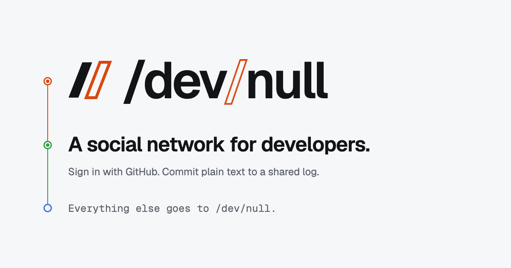

<p align="center">
    
    <p align="center">
        <a href="https://github.com/dev-null-sh/dev-null.sh/actions"></a>
        <a href="https://dev-null.sh"></a>
        <a href="https://github.com/dev-null-sh/dev-null.sh/graphs/contributors"></a>
        <a href="composer.json"></a>
    </p>
</p>

------

This is the source code of **[dev-null.sh](https://dev-null.sh)**, a social network for developers. Sign in with GitHub, follow developers, and share commits.

/dev/null was started live on stream by [Nuno Maduro](https://github.com/nunomaduro), [Brent Roose](https://github.com/brendt), [Matthieu Napoli](https://github.com/mnapoli), and [Pauline Vos](https://github.com/paulinevos), and is built by its community. Anyone can open a pull request.

- Join at **[dev-null.sh »](https://dev-null.sh)**
- Read the story at **[dev-null.sh/about »](https://dev-null.sh/about)**
- Learn how it works in the **[knowledge base »](KNOWLEDGE_BASE.md)**

## Contributing

Requires PHP 8.5+, Composer, Bun, and PostgreSQL 17+ with `pgvector` and `pg_trgm`. Create a `devnull` database, then:

```bash
git clone https://github.com/dev-null-sh/dev-null.sh.git
cd dev-null.sh
composer setup
composer dev
```

Run `composer test` before opening a pull request.

Commits are attributed to people only: never add Amp, Claude Code, or any other AI tool as a co-author, and keep their names out of commit attribution (author, committer, and trailers).

### Amp orbs

Amp runs `.agents/setup` to prepare a reusable snapshot with PHP 8.5, Composer, Node 26, the Bun version from `package.json`, locked dependencies, generated routes, and built assets. Setup also prepares isolated PostgreSQL 18 development and test databases with `vector` and `pg_trgm`, including extensions inherited by parallel test databases. It is safe to rerun and preserves an existing `.env` and application key.

Run `amp orb services ensure` to start the supervised database and app and print the app's portal URL. The app uses the existing local sign-in flow (any handle, no GitHub credentials required). Frontend assets are prebuilt; rerun `bun run build` after frontend edits. No resume hook is needed: Amp supervises the services, and dependency installation belongs only in setup.

The database is loopback-only and uses trust authentication and relaxed durability for disposable development data. Do not use this configuration for production.

## License

/dev/null is open-sourced software licensed under the **[MIT license](composer.json)**.
